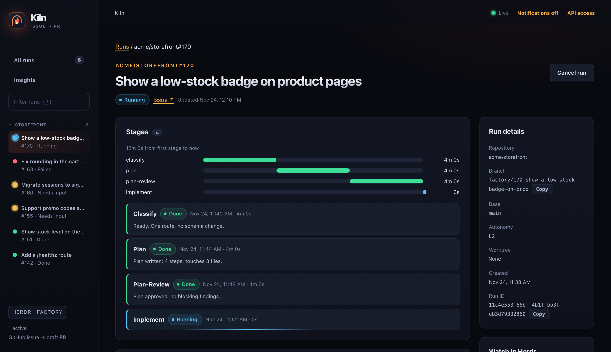
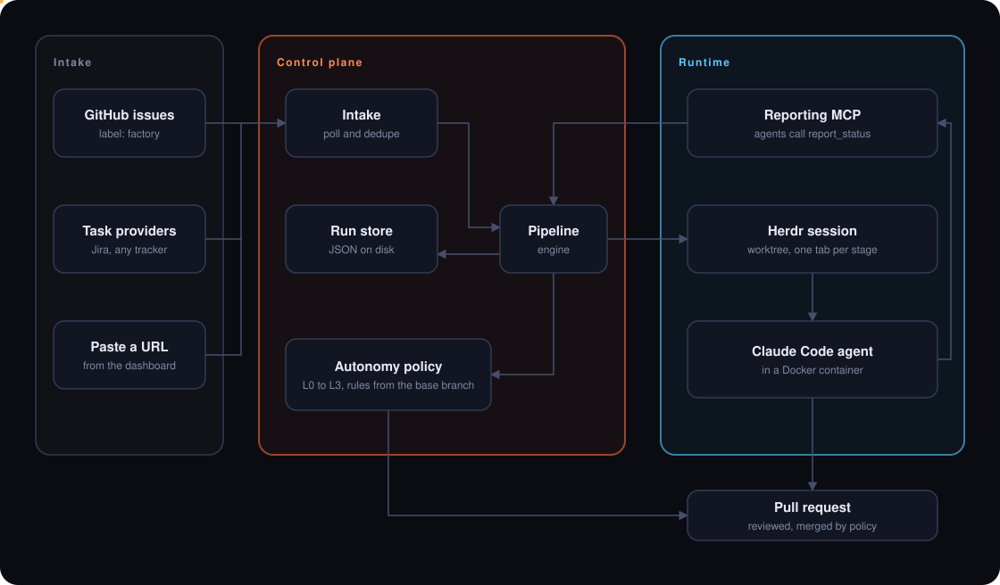
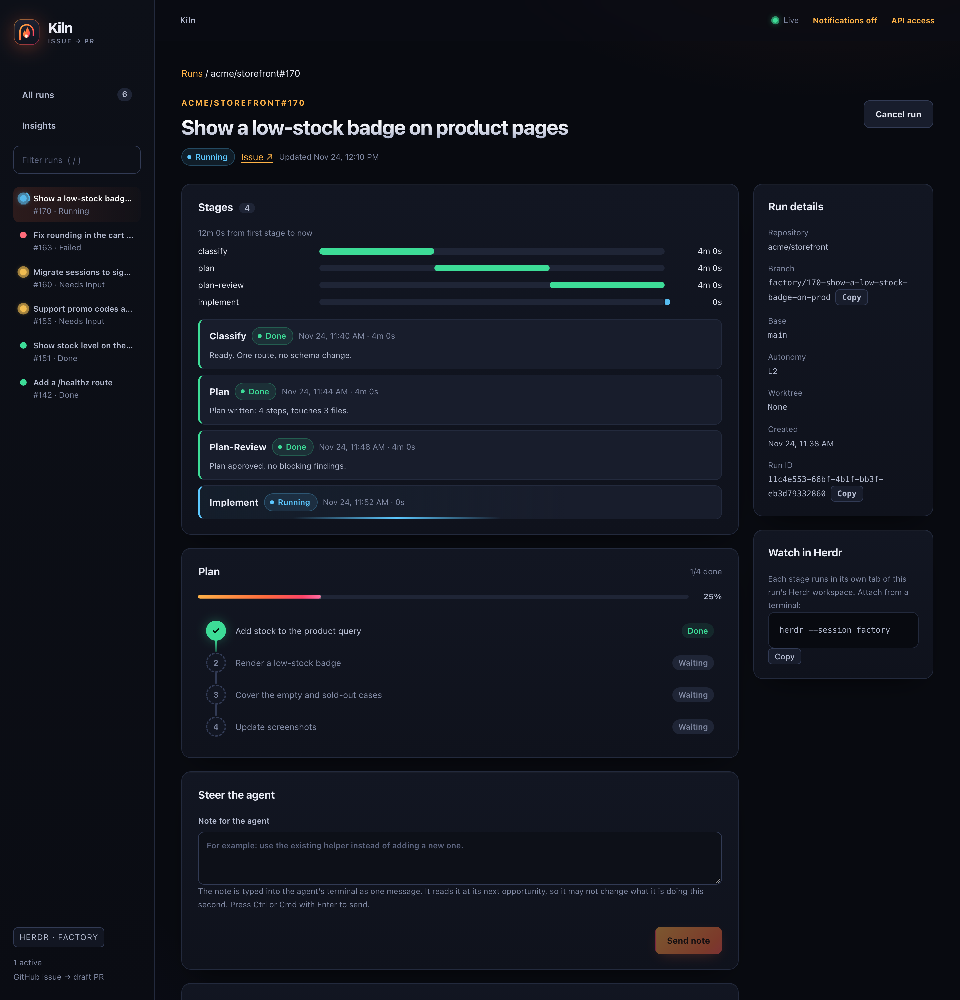
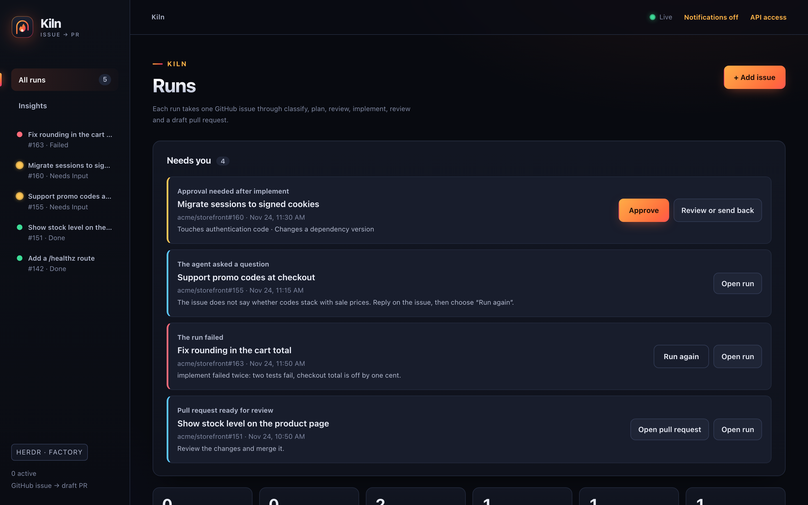
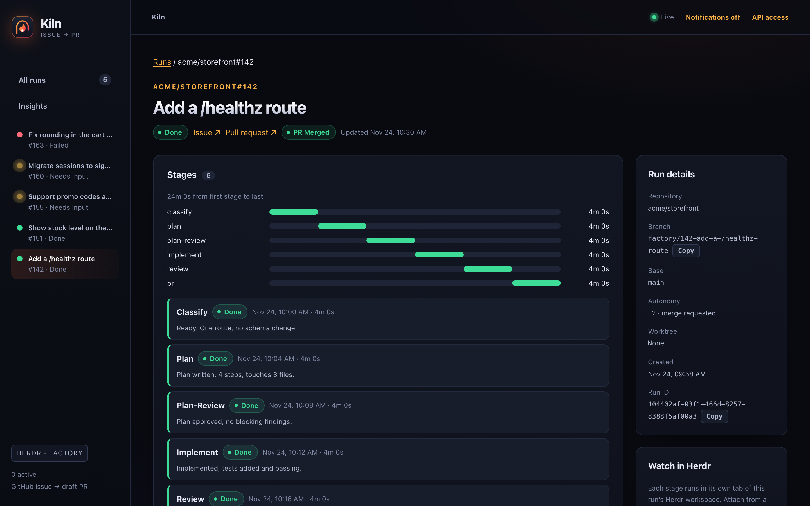
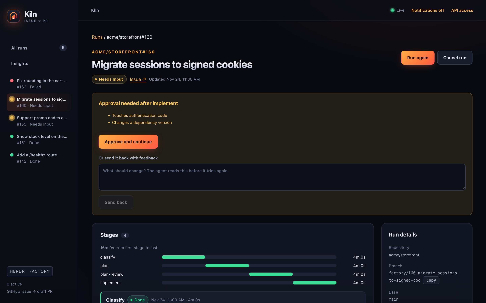
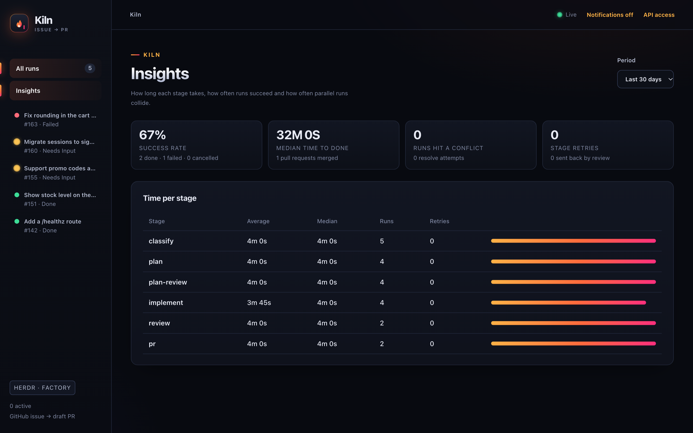

<p align="center">
  
</p>

<h1 align="center">Kiln</h1>

<p align="center">
  <b>Label an issue. Get a reviewed pull request.</b><br>
  Kiln runs a pipeline of Claude Code agents, each in its own container and terminal, reviews the result, and merges it when your merge policy allows, or holds it for you.
</p>

<p align="center">
  <a href="https://eeshdarthvader.github.io/kiln/">Website</a> ·
  <a href="#how-it-works">How it works</a> ·
  <a href="#features">Features</a> ·
  <a href="#quick-start">Quick start</a> ·
  <a href="apps/control-plane/README.md">Control plane docs</a> ·
  <a href="apps/runtime/README.md">Runtime docs</a> ·
  <a href="docs/architecture.html">Interactive diagram</a>
</p>

---

<p align="center">
  
</p>

## How it works

Add the `factory` label to a GitHub issue (or a Jira ticket). Kiln picks it up, and a server-driven
pipeline walks it through six stages. Every stage is a fresh Claude Code agent in a Docker
container, inside a [Herdr](https://herdr.dev) terminal you can attach to at any time.

<p align="center">
  <a href="https://htmlpreview.github.io/?https://github.com/eeshdarthvader/kiln/blob/main/docs/architecture.html">
    
  </a>
  <br>
  <sub><a href="https://htmlpreview.github.io/?https://github.com/eeshdarthvader/kiln/blob/main/docs/architecture.html">Open the interactive version</a>: click any block to see what it does.</sub>
</p>

| Stage         | What the agent does                                                                          |
| ------------- | -------------------------------------------------------------------------------------------- |
| `classify`    | Decides whether the issue is ready; asks if it is not                                        |
| `plan`        | Writes the implementation plan                                                               |
| `plan-review` | Reviews the plan; can send it back                                                           |
| `implement`   | Makes the change, runs the tests, commits                                                    |
| `review`      | Reviews the diff and reruns checks; can send it back                                         |
| `pr`          | Pushes the branch and opens a PR that links the issue; the policy then merges it or holds it |
| `resolve`     | Out of sequence: merges conflicts when parallel runs collide                                 |

<details>
<summary><b>Explore the blocks</b> (click to open)</summary>

<br>

<details>
<summary><b>Intake</b>: how work arrives</summary>

Polls watched repositories for the trigger label every 60 seconds, accepts a pasted issue URL, and
reads tickets from external trackers through task providers. A stopped run restarts when its label
is applied again. Source: [`src/github/intake.ts`](apps/control-plane/src/github/intake.ts),
[`src/tasks`](apps/control-plane/src/tasks).
</details>

## The dashboard

<table>
  <tr>
    <td colspan="2"><br><sub><b>A run in progress.</b> Live stage timeline, plan progress, and a note box to steer the agent mid-run.</sub></td>
  </tr>
  <tr>
    <td width="50%"><br><sub><b>Runs.</b> What needs you first: approvals, agent questions, failures, PRs to review.</sub></td>
    <td width="50%"><br><sub><b>Run detail.</b> Stage timeline, plan, changes, and the Herdr attach command.</sub></td>
  </tr>
  <tr>
    <td width="50%"><br><sub><b>Approval gate.</b> Critical changes pause for you: approve, or send back with feedback.</sub></td>
    <td width="50%"><br><sub><b>Insights.</b> Success rate, time to done, and where each stage spends its time.</sub></td>
  </tr>
</table>

<details>
<summary><b>Pipeline engine</b>: the brain</summary>

A state machine that starts each stage, waits for the agent's report, loops review stages back
(max 2), enforces timeouts and attempt caps, limits concurrency, and resumes in-flight runs after a
restart. Source: [`src/pipeline.ts`](apps/control-plane/src/pipeline.ts).
</details>

<details>
<summary><b>Autonomy policy</b>: who decides</summary>

The server, not the agents, decides what is critical, using rules read from the base branch's
`.factory/policy.json`. L0 and L1 stop at a draft PR for a human; L2 reviews and merges unless something critical needs a
human; L3 merges everything that passes. Source:
[`src/policy.ts`](apps/control-plane/src/policy.ts).
</details>

<details>
<summary><b>Herdr + agents</b>: where work happens</summary>

Each run gets a git worktree and a Herdr workspace with one tab per stage. The agent is Claude Code
in a container that sees only that worktree, the repository clone and the run directory. Source:
[`apps/runtime`](apps/runtime).
</details>

<details>
<summary><b>Reporting MCP</b>: how agents talk back</summary>

Agents call `report_status` on a per-run, per-stage URL to finish a stage, ask a question, send a
plan, attach decisions or evidence. Writes are idempotent. Source:
[`src/mcp.ts`](apps/control-plane/src/mcp.ts).
</details>

<details>
<summary><b>Dashboard</b>: your view</summary>

React, served by the server and updated live over server-sent events. Board and list views, a
stage timeline, a changed-files panel, a Needs-you inbox, insights, and a shell in the run's
worktree. Source: [`ui/`](apps/control-plane/ui).
</details>

</details>

## Features

**Intake**

- **Label to start:** put `factory` on a GitHub issue and a run starts, no clicks.
- **Paste a URL:** add any issue or ticket from the dashboard.
- **Task providers:** pull work from Jira, or any tracker with labels and comments, and mirror state back.
- **Status labels:** the issue shows `factory:in-progress`, `:needs-input`, `:failed` and `:done` as the run moves.

**Pipeline**

- **Six-stage pipeline:** classify, plan, plan-review, implement, review, pull request.
- **Review loops:** a reviewer can send the plan or the code back for another pass.
- **Asks when unsure:** an unclear issue stops the run and posts a question on the issue.
- **Parallel runs:** several runs work at once, each on its own branch and worktree.
- **Conflict resolution:** a `resolve` agent fixes conflicts before the PR and after another run merges first.
- **Crash-safe:** runs persist to disk, resume after a restart, and time out instead of hanging.

**Autonomy and safety**

- **Autonomy levels L0 to L3:** from "never merge" to "merge anything that passes".
- **Server-side policy:** critical paths, one-way decisions and high-risk changes always need a human at L2.
- **Policy from the base branch:** an agent cannot loosen the rules on its own branch.
- **Risk flag:** the reviewer marks drastic logic changes for a human.
- **Sandboxed agents:** each stage runs in a container that sees only its worktree.
- **Secrets stay out:** credentials come from your environment and never enter the run record or logs.

**Dashboard**

- **Live everything:** server-sent events keep runs, stages and PR state current.
- **Board and list:** see every run by stage, or as a queue.
- **Run sidebar:** every run one click away, with animated status dots.
- **Stage timeline:** when each stage started, how long it took, how many attempts.
- **Animated plan:** a progress meter and steps that complete as the agent works.
- **Changes panel:** files touched, with added and deleted lines.
- **Needs-you inbox:** approvals, questions and failures collected in one place.
- **Overlap warnings:** runs that touch the same files are flagged before they conflict.
- **Insights:** durations, success rates and where time goes.
- **Notifications:** be told when a run needs you.
- **Approve or send back:** accept a held change, or return it with feedback the agent reads.
- **Live agent output:** the stage's terminal, refreshed while it runs.
- **Web shell:** a terminal in the run's worktree to fix things on the fly.
- **Accessible:** keyboard friendly, labelled, and respects reduced motion.

**Pull requests**

- **Reviewed PRs:** each describes the change, links the issue or ticket and lists known limits, and an agent reviews it before it opens.
- **PR state tracking:** draft, open, merged or closed, kept up to date.
- **Merge by policy:** L0 and L1 leave a draft for a human; L2 and L3 merge, or queue the merge until checks pass, and hold critical changes for approval.
- **Decisions and evidence:** agents attach the trade-offs they weighed.

## Quick start

```bash
scripts/setup.sh      # checks your tools, installs, writes .env, builds the agent container
```

It never overwrites an existing `.env`, and `--check` only reports what is missing. To do it by
hand:

```bash
npm install                                  # once, from the repository root
cp apps/control-plane/.env.example apps/control-plane/.env
make -C apps/runtime agent-image             # build the agent container
herdr --session factory server &             # the terminal layer
npm run dev                                  # control plane at http://127.0.0.1:3775
```

Set `FACTORY_REPOS=owner/repo`, give the factory a GitHub login (`gh auth login`) and a Claude
credential (`CLAUDE_CODE_OAUTH_TOKEN` from `claude setup-token`), then label an issue. Everything
else is in the [control plane](apps/control-plane/README.md) and [runtime](apps/runtime/README.md)
READMEs.

## Repository layout

| Path                                                 | What it is                                                          |
| ---------------------------------------------------- | ------------------------------------------------------------------- |
| [`apps/control-plane`](apps/control-plane/README.md) | The server and dashboard: intake, pipeline, autonomy policy, API    |
| [`apps/runtime`](apps/runtime/README.md)             | Where agents run: Herdr client, agent container image, web terminal |

The control plane reaches the runtime only through the `AgentRuntime` interface in
[`apps/runtime/src/contract.ts`](apps/runtime/src/contract.ts).

New apps and shared packages go under `apps/` and `packages/` (npm workspaces).

```bash
npm run dev            # control plane with reload
npm test               # every workspace
```
